<a name="readme-top"></a>

<div align="center">

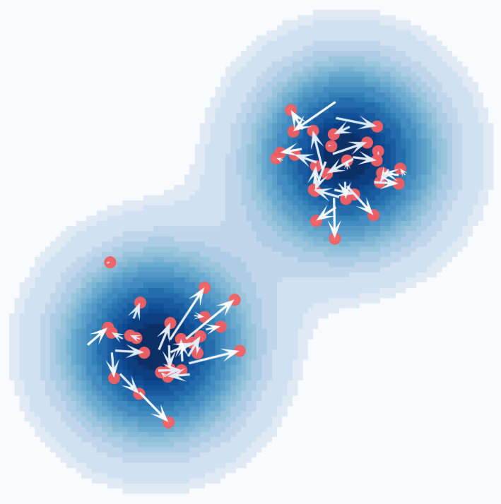

# Noise-Guided Smooth Latent Flow Matching

### Interpretability and Conditional Generation with Flow-Matching Models

**Self-supervised *self-guidance* for flow matching: a β-VAE learns a compact, smooth and decodable latent space<br>from the guidance-free noise space of a pre-trained SiT-XL/2 — no labels, no prompts, no retraining of the base model.**

[](docs/20250909_MasterThesis_Presentation_JaninaMattes.pdf)
[](#-quickstart)
[](#-citation)


[](LICENSE.txt)

<table>
  <tr>
    <td colspan="2" align="center">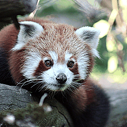</td>
    <td colspan="2" align="center">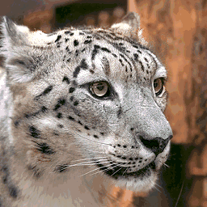</td>
  </tr>
  <tr>
    <td align="center">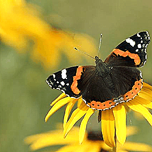</td>
    <td align="center">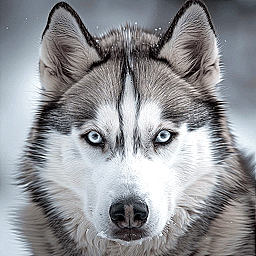</td>
    <td align="center">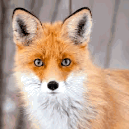</td>
    <td align="center">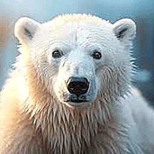</td>
  </tr>
</table>

<sub><i>Linear interpolations between two self-guidance codes in the auxiliary Bayesian latent space (β-VAE 0.50 → 1.00, β = 0.1), decoded by the self-guided DiT-XL/2 velocity decoder on ImageNet 256×256.</i></sub>

</div>

---

> [!IMPORTANT]
> **📑 Master's thesis defence, 09.09.2025** — the slides summarise motivation, method, ablations and qualitative results:
> **[`docs/20250909_MasterThesis_Presentation_JaninaMattes.pdf`](docs/20250909_MasterThesis_Presentation_JaninaMattes.pdf)**
> <br>M.Sc. Computer Science, Ludwig Maximilian University of Munich · Supervisor: Prof. Dr. Björn Ommer · Advisors: Johannes Schusterbauer, Ming Gui

<details>
<summary><b>Table of Contents</b></summary>

1. [Overview](#-overview)
2. [Method](#-method)
3. [Results](#-results)
4. [Quickstart](#-quickstart)
5. [Experiment Tracking](#-experiment-tracking)
6. [Repository Structure](#-repository-structure)
7. [Limitations & Future Work](#-limitations--future-work)
8. [Citation](#-citation)
9. [References](#-references)

</details>

## ✨ Overview

Although diffusion models remain the architecture of choice, the theoretically simpler, deterministic and nearly invertible **flow matching** paradigm [[1](#ref-1), [2](#ref-2), [3](#ref-3)] is gaining increasing traction. Its internal latent structures, however, remain high-dimensional, distributed along the generative trajectory and little understood, which limits **explainability and control**. Current de facto guidance methods such as classifier-free guidance [[4](#ref-4)] additionally depend on external signals and typically require paired, annotated data.

This work proposes a **hybrid framework** that integrates two complementary approaches within a decoupled generative architecture: a probabilistic, disentangled representation learner (β-VAE [[5](#ref-5), [6](#ref-6)]) and a high-fidelity generative flow matching model (SiT-XL/2 [[7](#ref-7), [8](#ref-8)]). An auxiliary Bayesian encoder extracts high-level semantic codes from the learned **guidance-free noise space** [[9](#ref-9), [10](#ref-10)] of a pre-trained flow matching encoder, yielding a **compact, smooth, decodable and interpretable** representation. These internally derived codes replace external conditioning — we call this **self-guidance** [[11](#ref-11), [12](#ref-12)].

**Contributions**

- 🔍 **Guidance-free noise spaces in flow matching.** Forward ODE integration of a pre-trained SiT-XL/2 maps every image to a unique, semantically structured noise code $\boldsymbol{x}_t$ that reconstructs the input without external guidance (cycle-consistency) [[9](#ref-9), [13](#ref-13)].
- 🧭 **Self-guidance.** A β-VAE distils $\boldsymbol{x}_t$ into a non-spatial code $\boldsymbol{z}_t \in \mathbb{R}^{1024}$ that conditions a separate velocity decoder, enabling multi-level semantic control **without paired datasets**.
- 🎛️ **Frequency-aware, decoupled design.** The encoder specialises in low-frequency global semantics, the decoder restores high-frequency detail — mirroring the coarse-to-fine spectral behaviour of diffusion and flow models [[14](#ref-14), [12](#ref-12), [15](#ref-15)].
- 🌊 **Smooth, interpretable latent space.** Linear walks in the Bayesian $\mathcal{Z}$-space yield consistent attribute-level manipulations and robust interpolation; latent smoothness is quantified with latent variants of PPL and ISTD [[16](#ref-16), [17](#ref-17)].
- 🔌 **Plug-and-play.** The framework can be applied to existing generative models **without retraining** the base model [[18](#ref-18), [19](#ref-19)].

<p align="right">(<a href="#readme-top">back to top</a>)</p>

## 🧠 Method

<p align="center">
  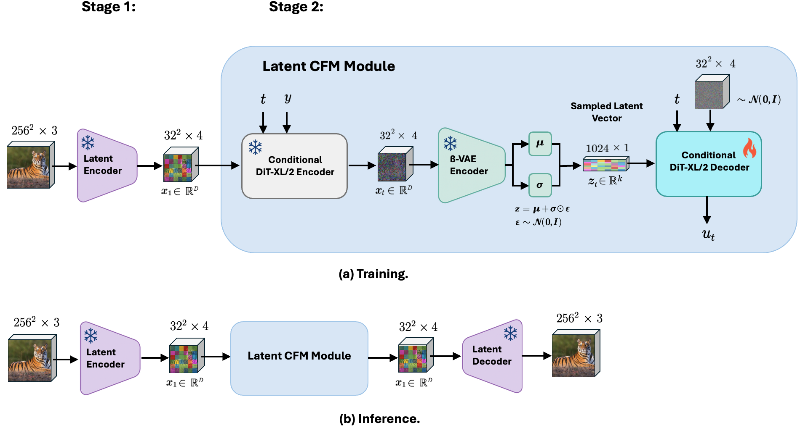
</p>
<p align="center"><sub><b>Overview of the proposed multi-stage framework.</b> (a) Training: latent compression (Stage 1) is followed by conditional flow-based generation (Stage 2). (b) Inference: reverse-time sampling from noise, guided by the semantic codes $\boldsymbol{z}_t$. ❄️ frozen, 🔥 trained.</sub></p>

We refer to the resulting model class as **Latent Conditional Flow Matching (LCFM)**. Following standard practice [[20](#ref-20)], training and inference are divided into two stages.

> **Time convention.** As in recent flow matching literature [[1](#ref-1), [21](#ref-21)], time flows forward from a Gaussian source $p_0$ at $t = 0$ to the data distribution $p_1$ at $t = 1$. Experiments are named **$t_\text{source} \rightarrow t_\text{target}$**: the β-VAE encodes $\boldsymbol{x}_{t_\text{source}}$ and reconstructs $\boldsymbol{x}_{t_\text{target}}$ (e.g. $0.50 \rightarrow 1.00$ is a *denoising* task, $0.50 \rightarrow 0.50$ a *reconstruction* task).

### Stage 1 — Semantic latent compression

The pre-trained, frozen KL-autoencoder of Latent Diffusion [[20](#ref-20)] maps an image $\boldsymbol{x} \in \mathbb{R}^{256 \times 256 \times 3}$ to a latent $\boldsymbol{x}_1 = \mathcal{E}_\varphi(\boldsymbol{x}) \in \mathbb{R}^{32 \times 32 \times 4}$ (downsampling factor $f = 8$, scaling factor $0.18215$). This removes imperceptible high-frequency detail while preserving semantic content; all further components operate in this latent space $\mathcal{W}$.

### Stage 2 — Latent conditional flow matching

**Flow matching background.** A one-sided linear interpolant defines straight conditional paths from noise $\boldsymbol{x}_0 \sim \mathcal{N}(\mathbf{0}, \mathbf{I})$ to data $\boldsymbol{x}_1 \sim p_1$ with a constant target velocity [[1](#ref-1), [3](#ref-3), [21](#ref-21)]:

```math
\boldsymbol{x}_t = (1 - t)\,\boldsymbol{x}_0 + t\,\boldsymbol{x}_1, \qquad \boldsymbol{u}_t = \frac{d\boldsymbol{x}_t}{dt} = \boldsymbol{x}_1 - \boldsymbol{x}_0 .
```

A neural velocity field $\boldsymbol{v}_\theta$ is regressed onto this target with the **conditional flow matching** objective [[1](#ref-1), [22](#ref-22)]; samples are generated by integrating the probability flow ODE $d\boldsymbol{x}_t/dt = \boldsymbol{v}_\theta(\boldsymbol{x}_t, t)$ with a first-order Euler solver (50 steps).

<details>
<summary><b>Why straight paths and an ODE?</b></summary>
<br>

The flow $\boldsymbol{\phi}_t$ of a smooth velocity field pushes the source density forward, $p_t = (\boldsymbol{\phi}_t)_{\sharp}\, p_0$, and its evolution obeys the continuity equation $\partial_t p_t = -\nabla \cdot (p_t\, \boldsymbol{u}_t)$. Regressing $\boldsymbol{v}_\theta$ on the intractable marginal field $\boldsymbol{u}_t(\boldsymbol{x})$ is replaced by regression on the closed-form *conditional* field $\boldsymbol{u}_t(\boldsymbol{x} \mid \boldsymbol{x}_0, \boldsymbol{x}_1)$; both objectives have identical gradients [[1](#ref-1)]. Under a Gaussian source the conditional flows are optimal-transport paths: straighter, lower-curvature trajectories that need fewer function evaluations and accumulate less discretisation error than the curved paths of SDE-based diffusion models [[23](#ref-23), [24](#ref-24)]. Because the dynamics are deterministic, the forward ODE is (approximately) invertible, which is the cycle-consistency property exploited below [[13](#ref-13)].

</details>

#### ① Guidance-free noise space (class-conditional SiT-XL/2 encoder, frozen)

A pre-trained, class-conditional SiT-XL/2 [[7](#ref-7), [8](#ref-8)] defines a time-dependent velocity field $\boldsymbol{v}_\theta(\boldsymbol{x}_t, t, \boldsymbol{y})$. Integrating it **forward in time** transports each clean latent $\boldsymbol{x}_1$ along approximately straight conditional OT paths towards the Gaussian prior, producing progressively noisier latent states $\boldsymbol{x}_t$ that define a flow-based latent space $\mathcal{V}$. We refer to it as a **guidance-free noise space** [[9](#ref-9)]: unlike i.i.d. Gaussian noise, its codes remain linearly correlated with object shape, colour distribution, viewpoint and class identity, and reconstruct their input without additional guidance. The guidance scale is fixed to $\omega = 1$ (the native conditional velocity) to avoid over-saturation and preserve diversity [[4](#ref-4), [25](#ref-25)].

<p align="center">
  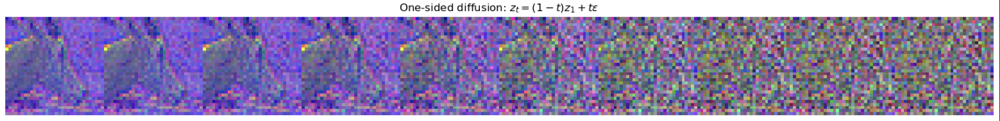
</p>

**Dataset.** The resulting *Guidance-Free ImageNet-256* dataset contains **500k training, 100k validation and 10k test pairs** $(\boldsymbol{x}_1, \boldsymbol{x}_t)$ from ImageNet-256 [[26](#ref-26)] (class-balanced, ≈208 GB), with $t$ discretised on $\{1.0, 0.9, \dots, 0.0\}$.

#### ② β-VAE self-guidance encoder (trained)

A fully transformer-based, symmetric **Skip-ViT β-VAE** [[5](#ref-5), [27](#ref-27)] (12 encoder + 12 decoder blocks, patch size 2, ≈80M parameters) compresses $\boldsymbol{x}_t$ into a global, non-spatial bottleneck token $\boldsymbol{z}_t \in \mathbb{R}^{1024}$. Long-range **cross-attention skip connections** inside encoder and decoder improve gradient flow, while cross-connections between the two networks are deliberately omitted to keep a true information bottleneck. The objective balances reconstruction and regularisation towards an isotropic Gaussian prior [[5](#ref-5), [28](#ref-28)]:

```math
\mathcal{L}_{\beta\text{-VAE}}(\theta, \phi; \boldsymbol{x}_t) = - \mathbb{E}_{q_\phi(\boldsymbol{z}_t \mid \boldsymbol{x}_t)}\big[\log p_\theta(\boldsymbol{x}_{t_\text{target}} \mid \boldsymbol{z}_t)\big] + \beta \, D_\mathrm{KL}\big(q_\phi(\boldsymbol{z}_t \mid \boldsymbol{x}_t) \,\|\, \mathcal{N}(\mathbf{0}, \mathbf{I})\big)
```

Higher $\beta$ limits bottleneck capacity and encourages disentangled, axis-aligned factors; lower $\beta$ retains more detail — the classic disentanglement–fidelity trade-off.

#### ③ Self-guided flow matching decoder (trained)

Because the lossy bottleneck discards high-frequency detail, a **context-conditional DiT-XL/2 velocity decoder** (initialised from SiT-XL/2, 677M parameters) transports Gaussian noise back to the latent image manifold. $\boldsymbol{z}_t$ is projected by a two-layer MLP, appended to the token sequence and injected into every block via AdaLN-Zero [[8](#ref-8), [12](#ref-12)]:

```math
\mathcal{L}_\text{CFM}(\theta) = \mathbb{E}_{t \sim \mathcal{U}(0,1),\, \boldsymbol{x}_0 \sim \mathcal{N}(\mathbf{0}, \mathbf{I}),\, \boldsymbol{x}_1 \sim p_1} \big\| \boldsymbol{v}_\theta(\boldsymbol{x}_t, t, \boldsymbol{z}_t) - (\boldsymbol{x}_1 - \boldsymbol{x}_0) \big\|^2
```

#### ④ Self-guidance algorithm

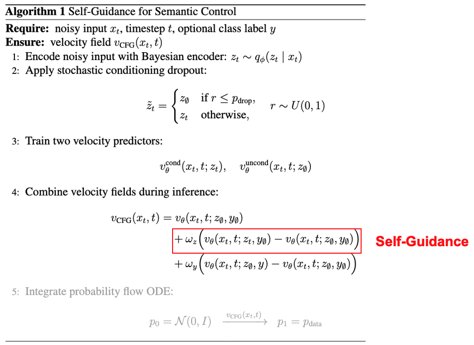

Inspired by classifier-free guidance [[4](#ref-4)], conditioning dropout replaces $\boldsymbol{z}_t$ by a learnable null token $\boldsymbol{z}_\varnothing$ with $p_\text{drop} = 0.1$ (and optionally the class label $\boldsymbol{y}$ by $\boldsymbol{y}_\varnothing$). At inference, two independently tunable scales steer **self-guidance** ($\omega_z$) and **class guidance** ($\omega_y$) around a shared unconditional base velocity:

```math
\begin{aligned}
\boldsymbol{v}_\text{CFG}(\boldsymbol{x}_t, t) = \;& \boldsymbol{v}_\theta(\boldsymbol{x}_t, t; \boldsymbol{z}_\varnothing, \boldsymbol{y}_\varnothing) \\
&+ \omega_z \big(\boldsymbol{v}_\theta(\boldsymbol{x}_t, t; \boldsymbol{z}_t, \boldsymbol{y}_\varnothing) - \boldsymbol{v}_\theta(\boldsymbol{x}_t, t; \boldsymbol{z}_\varnothing, \boldsymbol{y}_\varnothing)\big) \\
&+ \omega_y \big(\boldsymbol{v}_\theta(\boldsymbol{x}_t, t; \boldsymbol{z}_\varnothing, \boldsymbol{y}) - \boldsymbol{v}_\theta(\boldsymbol{x}_t, t; \boldsymbol{z}_\varnothing, \boldsymbol{y}_\varnothing)\big)
\end{aligned}
```

| Scale | Effect |
|---|---|
| $\omega = 0$ | unconditional model |
| $\omega = 1$ | standard conditional model |
| $\omega > 1$ | sharpens the conditional distribution towards high-probability modes |

<br clear="right"/>

<p align="right">(<a href="#readme-top">back to top</a>)</p>

## 📊 Results

All β-VAE models share architecture, hyper-parameters and optimisation settings. Fidelity is measured in latent space (PSNR, MSE, MAE, cosine similarity); **latent smoothness** along linear interpolations with **L-PPL** and **L-ISTD** — latent variants of perceptual path length [[16](#ref-16)] and inter-step distance [[17](#ref-17)] that isolate encoder quality from decoder effects (values ×10⁻⁴, lower is smoother).

<details open>
<summary><b>Effect of the source noise level</b> (denoising, t<sub>target</sub> = 1.00, β = 0.1)</summary>
<br>

| $t_\text{source} \rightarrow t_\text{target}$ | PSNR ↑ | MSE ↓ | MAE ↓ | CosSim ↑ | L-PPL ↓ | L-ISTD ↓ |
|---|---|---|---|---|---|---|
| 0.00 → 1.00 | 17.41 | 0.0182 | 0.108 | 0.969 | **0.3015** | **0.0512** |
| 0.20 → 1.00 | 17.24 | 0.0189 | 0.110 | 0.957 | 0.8077 | 0.1122 |
| 0.30 → 1.00 | 18.70 | 0.0135 | 0.093 | 0.976 | 0.3253 | 0.0551 |
| 0.40 → 1.00 | 19.38 | 0.0115 | 0.086 | 0.979 | 0.3018 | 0.0513 |
| 0.50 → 1.00 | **20.94** | **0.0100** | **0.079** | **0.981** | 0.5709 | 0.1194 |

Medium noise yields the **highest fidelity**: enough residual structure remains to recover the clean manifold. Pure noise ($t = 0$) gives the smoothest paths, but strong corruption smooths the input signal and may cause collapse or trivial solutions.

</details>

<details>
<summary><b>Effect of the β regularisation strength</b> (0.20 → 1.00)</summary>
<br>

| $\beta$ | PSNR ↑ | MSE ↓ | MAE ↓ | CosSim ↑ | L-PPL ↓ | L-ISTD ↓ |
|---|---|---|---|---|---|---|
| 1e-4 | **17.75** | **0.0118** | **0.1031** | 0.9694 | 0.8463 | 0.1243 |
| 0.1 | 17.24 | 0.0189 | 0.1096 | 0.9568 | 0.8077 | 0.1122 |
| 0.5 | 16.59 | 0.0270 | 0.1318 | 0.9542 | 0.8753 | 0.1542 |
| 1.0 (standard VAE) | 17.57 | 0.0175 | 0.1052 | 0.9648 | 0.5305 | 0.0884 |
| 2.0 | 17.45 | 0.0127 | 0.1190 | 0.9606 | **0.5015** | **0.0702** |
| 3.0 | 17.18 | 0.0192 | 0.1105 | 0.9670 | 0.8878 | 0.1044 |
| 5.0 | 14.99 | 0.0317 | 0.1564 | **0.9808** | 0.8515 | 0.1169 |

The **disentanglement–fidelity trade-off**: the lowest β lets the encoder capture the most fine-grained information, while smoothness follows a **U-shaped** trend with its optimum at β = 2.0 — very low and very high bottleneck pressure both reduce smoothness.

<p align="center">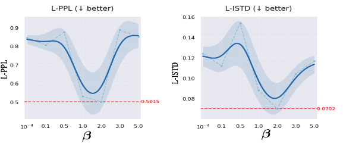</p>

</details>

<details>
<summary><b>Self-guidance scale ω<sub>z</sub></b> (0.50 → 1.00, β = 0.1, no external class labels, 50k samples, 50 Euler steps)</summary>
<br>

| $\omega_z$ | gFID ↓ | LPIPS ↓ | SSIM ↑ | PSNR ↑ | MSE ↓ |
|---|---|---|---|---|---|
| 1 | 50.10 | 0.556 | 0.305 | 15.78 | 0.0298 |
| **3** | **24.50** | **0.495** | **0.371** | **18.65** | **0.0212** |
| 5 | 38.90 | 0.535 | 0.333 | 16.21 | 0.0395 |
| 7 | 50.60 | 0.570 | 0.306 | 15.12 | 0.0460 |
| 9 | 62.40 | 0.608 | 0.280 | 14.21 | 0.0528 |

Intermediate guidance ($\omega_z \approx 3$) performs best [[29](#ref-29), [30](#ref-30)]; stronger guidance over-constrains generation, reduces entropy and leads to over-smoothed or over-saturated samples.

</details>

### Self-guided reconstructions

<p align="center">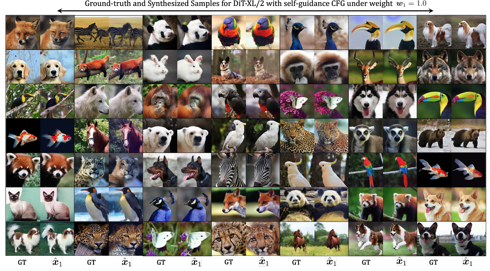</p>

Reconstructions maintain **layout, colour distribution, lighting and object location** of the ground truth. Fine-grained stochastic detail remains challenging — very small objects, background foliage and distinctive patterns such as leopard spots or fish scales.

### Semantically meaningful latent interpolation

Linear interpolation between two self-guidance codes assumes a locally Euclidean $\mathcal{Z}$-space shaped by the KL regularisation. Below, fur patterns are manipulated while background, posture and facial expression of the source are preserved:

<p align="center">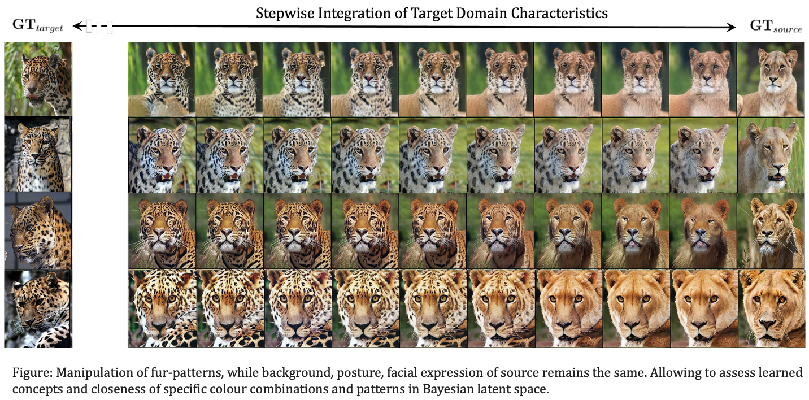</p>

High-frequency textures (e.g. fur) can persist longer than coarse features such as posture — a perceptual *"sticky"* effect, since latent axes of the β-VAE are regularised but not semantically guaranteed.

<p align="right">(<a href="#readme-top">back to top</a>)</p>

## 🚀 Quickstart

**Requirements:** Python 3.12, [uv](https://docs.astral.sh/uv/), a CUDA GPU for real training (the smoke test runs on CPU).

```bash
git clone https://github.com/JaninaMattes/NoiseGuided-SmoothLFM.git
cd NoiseGuided-SmoothLFM
make install          # uv sync --locked: exact, pinned environment in .venv
make test             # configs compose, all targets import, tracking works  (~15 s)
make smoke            # trains both stages for 4 steps on dummy data, logged to MLflow
```

`make` lists all targets. Each experiment is **one command**:

```bash
# Stage 2a — β-VAE self-guidance encoder (thesis setting 0.50 -> 1.00, β = 0.1)
make train-bvae

# Ablations are plain Hydra overrides
make train-bvae ARGS="source_timestep=0.20 model.params.beta=5.0"

# Stage 2b — self-guided SiT-XL/2 velocity decoder on top of a trained β-VAE
make train-decoder BVAE_CKPT=logs_dir/imnet256/bvae-skipvit-b-2/.../checkpoints/last.ckpt

# Anything else
make experiment CONFIG=rf_config EXP=imnet256/sit-xl-2_context_cond ARGS="devices=4 use_wandb=True"
```

<details>
<summary><b>Data and checkpoints for the real experiments</b></summary>
<br>

| Artifact | Expected path | Source |
|---|---|---|
| SD KL-autoencoder (Stage 1) | `checkpoints/sd_ae.ckpt` | Latent Diffusion [[20](#ref-20)] |
| SiT-XL/2 256×256 (forward encoder, decoder init) | `checkpoints/SiT-XL-2-256x256.pt` | [willisma/SiT](https://github.com/willisma/SiT) |
| Guidance-free ImageNet-256 (HDF5) | `dataset/processed/...` (see `configs/data/imagenet256_hdf5_v0.yaml`) | built with `dataprocessing/pipeline/` |
| Trained β-VAE (for Stage 2b) | `BVAE_CKPT=...` | output of `make train-bvae` |

Paths are plain config values and can be overridden, e.g. `ARGS="data.params.hdf5_file=/data/gf-imagenet256.hdf5"`.

</details>

<details>
<summary><b>Configuration layout (Hydra)</b></summary>
<br>

| Root config | Trains | Key knobs |
|---|---|---|
| `configs/bvae_config.yaml` | β-VAE encoder (`ldm/trainer_bvae_ti2.py`) | `source_timestep`, `target_timestep`, `model.params.beta` |
| `configs/rf_config.yaml` | self-guided decoder (`ldm/trainer_rf_vae.py`) | `source_timestep`, `ldm_autoencoder`, `trainer_module.params.use_context` |

Config groups: `model/`, `data/`, `autoencoder/` (Stage 1), `flow/` (forward encoder), `ldm_autoencoder/` (frozen β-VAE), `metrics/`, `lr_scheduler/`, and `experiment/` (complete, reproducible settings — `imnet256/*` for the thesis, `smoke/*` for CI-style checks). `source_timestep`/`target_timestep` are set **once** at the root and propagate to the trainer and the data loaders.

</details>

<p align="right">(<a href="#readme-top">back to top</a>)</p>

## 📈 Experiment Tracking

Every run is stored under `logs_dir/<name>/<date>/<slurm-id | time>/` with its resolved `config.yaml` (including the launching command), checkpoints and a local `metrics.csv`. On top, runs are tracked in **MLflow** and/or **Weights & Biases**:

| Config key | Default | Effect |
|---|---|---|
| `use_mlflow` | `True` | MLflow run with parameters, per-step metrics, run info tags and `config.yaml` artifact |
| `mlflow_tracking_uri` | `file:./mlruns` | or set `MLFLOW_TRACKING_URI` to use a tracking server |
| `use_wandb` / `use_wandb_offline` | `False` | W&B run (online or offline) with the same metrics and config |
| `log_images` | `True` | sample and reconstruction grids are logged to **every** enabled backend |

```bash
make mlflow-ui                                   # http://127.0.0.1:5000
make train-bvae ARGS="use_wandb=True log_images=False"
```

If neither backend is enabled, TensorBoard is used as fallback. Smoke runs go to the separate MLflow experiment `smoke`. The logic lives in a single module, [`ldm/tracking.py`](ldm/tracking.py).

## 📁 Repository Structure

```
├── train.py                 # single training entry point (Hydra)
├── Makefile                 # one-command install / test / smoke / train / mlflow-ui
├── configs/                 # Hydra configs: root configs, groups and experiment/ presets
├── ldm/
│   ├── trainer_bvae_ti2.py  # Lightning module: β-VAE self-guidance encoder
│   ├── trainer_rf_vae.py    # Lightning module: self-guided flow matching decoder
│   ├── tracking.py          # MLflow / W&B / CSV loggers and image fan-out
│   ├── frameworks/          # flow matching (fm.py), β-VAE, autoencoders
│   ├── models/              # DiT/SiT backbones, Skip-ViT encoder/decoder, wrappers
│   ├── metrics/             # image and latent-noise metric trackers
│   └── dataloader/          # HDF5 / WebDataset / dummy data modules
├── dataprocessing/          # build the guidance-free HDF5 dataset
├── evaluation/              # quantitative & qualitative evaluation, smoothness metrics, plots
├── scripts/slurm/           # cluster launch scripts
├── tests/                   # config integrity and tracking tests
└── docs/                    # thesis presentation
```

<p align="right">(<a href="#readme-top">back to top</a>)</p>

## 🔭 Limitations & Future Work

- **Disentanglement vs. fidelity.** Fully disentangling latent factors while keeping high reconstruction accuracy remains hard — fine-grained and class-specific information is increasingly lost under high input noise and strong β, which can make the self-guidance signal ambiguous (e.g. a fox instead of a leopard).
- **Metrics.** FID, LPIPS or PSNR offer limited insight into latent representation quality; more rigorous measures of smoothness and controllability beyond L-PPL and L-ISTD are needed [[31](#ref-31)].
- **Robustness.** The self-conditioned velocity decoder struggles with out-of-distribution inputs, and global, non-spatial codes limit fine-grained spatial reasoning [[32](#ref-32)].
- **Directions.** Finding meaningful edit directions via linear probes on $\boldsymbol{z}_t$ [[19](#ref-19)], frequency-aware guidance [[15](#ref-15)], 3D conditioning for physically plausible interpolation [[33](#ref-33)], and temporal feature extraction for long-range interpolation [[34](#ref-34)] — building on the representation learning perspective of [[35](#ref-35), [36](#ref-36)].

## 📚 Citation

```bibtex
@mastersthesis{Mattes2025interpretability,
  author = {Janina Alica Mattes},
  title  = {Interpretability and Conditional Generation with Flow-Matching Models},
  school = {Ludwig Maximilian University of Munich},
  type   = {Master's thesis},
  year   = {2025}
}
```

## Acknowledgments

This work was carried out at the **Computer Vision & Learning Group (CompVis), LMU Munich**. Thanks to Prof. Dr. Björn Ommer and to Johannes Schusterbauer and Ming Gui for their supervision. The code builds on [SiT](https://github.com/willisma/SiT) [[7](#ref-7)], [DiT](https://github.com/facebookresearch/DiT) [[8](#ref-8)], [Latent Diffusion](https://github.com/CompVis/latent-diffusion) [[20](#ref-20)] and [jutils](https://github.com/joh-schb/jutils).

Distributed under the MIT License — see [`LICENSE.txt`](LICENSE.txt).

## 📖 References

<a id="ref-1"></a>[1] Y. Lipman, R. T. Q. Chen, H. Ben-Hamu, M. Nickel, and M. Le, "Flow matching for generative modeling," in *Proc. Int. Conf. Learn. Represent. (ICLR)*, 2023.<br>
<a id="ref-2"></a>[2] M. S. Albergo and E. Vanden-Eijnden, "Building normalizing flows with stochastic interpolants," in *Proc. Int. Conf. Learn. Represent. (ICLR)*, 2023.<br>
<a id="ref-3"></a>[3] X. Liu, C. Gong, and Q. Liu, "Flow straight and fast: Learning to generate and transfer data with rectified flow," in *Proc. Int. Conf. Learn. Represent. (ICLR)*, 2023.<br>
<a id="ref-4"></a>[4] J. Ho and T. Salimans, "Classifier-free diffusion guidance," in *Proc. NeurIPS Workshop Deep Generative Models and Downstream Applications*, 2021.<br>
<a id="ref-5"></a>[5] I. Higgins, L. Matthey, A. Pal, C. Burgess, X. Glorot, M. Botvinick, S. Mohamed, and A. Lerchner, "β-VAE: Learning basic visual concepts with a constrained variational framework," in *Proc. Int. Conf. Learn. Represent. (ICLR)*, 2017.<br>
<a id="ref-6"></a>[6] D. P. Kingma and M. Welling, "Auto-encoding variational Bayes," in *Proc. Int. Conf. Learn. Represent. (ICLR)*, 2014.<br>
<a id="ref-7"></a>[7] N. Ma, M. Goldstein, M. S. Albergo, N. M. Boffi, E. Vanden-Eijnden, and S. Xie, "SiT: Exploring flow and diffusion-based generative models with scalable interpolant transformers," in *Proc. Eur. Conf. Comput. Vis. (ECCV)*, 2024.<br>
<a id="ref-8"></a>[8] W. Peebles and S. Xie, "Scalable diffusion models with transformers," in *Proc. IEEE/CVF Int. Conf. Comput. Vis. (ICCV)*, 2023, pp. 4195–4205.<br>
<a id="ref-9"></a>[9] D. Ahn, J. Kang, S. Lee, J. Min, M. Kim, W. Jang, *et al.*, "A noise is worth diffusion guidance," arXiv preprint arXiv:2412.03895, 2024.<br>
<a id="ref-10"></a>[10] Z. Zhou, S. Shao, L. Bai, Z. Xu, B. Han, and Z. Xie, "Golden noise for diffusion models: A learning framework," arXiv preprint arXiv:2411.09502, 2024.<br>
<a id="ref-11"></a>[11] V. T. Hu, Y. Chen, M. Caron, Y. M. Asano, C. G. M. Snoek, and B. Ommer, "Guided diffusion from self-supervised diffusion features," arXiv preprint arXiv:2312.08825, 2024.<br>
<a id="ref-12"></a>[12] S. Wang, Z. Tian, W. Huang, and L. Wang, "DDT: Decoupled diffusion transformer," arXiv preprint arXiv:2504.05741, 2025.<br>
<a id="ref-13"></a>[13] X. Su, J. Song, C. Meng, and S. Ermon, "Dual diffusion implicit bridges for image-to-image translation," in *Proc. Int. Conf. Learn. Represent. (ICLR)*, 2023.<br>
<a id="ref-14"></a>[14] S. Dieleman, "Diffusion is spectral autoregression," Sep. 2024. [Online]. Available: https://sander.ai/2024/09/02/spectral-autoregression.html<br>
<a id="ref-15"></a>[15] S. Sadat, T. Vontobel, F. Salehi, and R. M. Weber, "Guidance in the frequency domain enables high-fidelity sampling at low CFG scales," arXiv preprint arXiv:2506.19713, 2025.<br>
<a id="ref-16"></a>[16] T. Karras, S. Laine, and T. Aila, "A style-based generator architecture for generative adversarial networks," in *Proc. IEEE/CVF Conf. Comput. Vis. Pattern Recognit. (CVPR)*, 2019, pp. 4401–4410.<br>
<a id="ref-17"></a>[17] J. Guo, X. Xu, Y. Pu, Z. Ni, C. Wang, M. Vasu, S. Song, G. Huang, and H. Shi, "Smooth diffusion: Crafting smooth latent spaces in diffusion models," in *Proc. IEEE/CVF Conf. Comput. Vis. Pattern Recognit. (CVPR)*, 2024.<br>
<a id="ref-18"></a>[18] K. Preechakul, N. Chatthee, S. Wizadwongsa, and S. Suwajanakorn, "Diffusion autoencoders: Toward a meaningful and decodable representation," in *Proc. IEEE/CVF Conf. Comput. Vis. Pattern Recognit. (CVPR)*, 2022, pp. 10619–10629.<br>
<a id="ref-19"></a>[19] M. Fuest, P. Ma, M. Gui, J. Schusterbauer, V. T. Hu, and B. Ommer, "Diffusion models and representation learning: A survey," arXiv preprint arXiv:2407.00783, 2024.<br>
<a id="ref-20"></a>[20] R. Rombach, A. Blattmann, D. Lorenz, P. Esser, and B. Ommer, "High-resolution image synthesis with latent diffusion models," in *Proc. IEEE/CVF Conf. Comput. Vis. Pattern Recognit. (CVPR)*, 2022, pp. 10684–10695.<br>
<a id="ref-21"></a>[21] M. S. Albergo, N. M. Boffi, and E. Vanden-Eijnden, "Stochastic interpolants: A unifying framework for flows and diffusions," arXiv preprint arXiv:2303.08797, 2023.<br>
<a id="ref-22"></a>[22] Y. Lipman, M. Havasi, P. Holderrieth, N. Shaul, M. Le, B. Karrer, R. T. Q. Chen, D. Lopez-Paz, H. Ben-Hamu, and I. Gat, "Flow matching guide and code," arXiv preprint arXiv:2412.06264, 2024.<br>
<a id="ref-23"></a>[23] Y. Song, J. Sohl-Dickstein, D. P. Kingma, A. Kumar, S. Ermon, and B. Poole, "Score-based generative modeling through stochastic differential equations," in *Proc. Int. Conf. Learn. Represent. (ICLR)*, 2021.<br>
<a id="ref-24"></a>[24] J. Song, C. Meng, and S. Ermon, "Denoising diffusion implicit models," in *Proc. Int. Conf. Learn. Represent. (ICLR)*, 2021.<br>
<a id="ref-25"></a>[25] P. Dhariwal and A. Q. Nichol, "Diffusion models beat GANs on image synthesis," in *Adv. Neural Inf. Process. Syst. (NeurIPS)*, vol. 34, 2021, pp. 8780–8794.<br>
<a id="ref-26"></a>[26] J. Deng, W. Dong, R. Socher, L.-J. Li, K. Li, and L. Fei-Fei, "ImageNet: A large-scale hierarchical image database," in *Proc. IEEE Conf. Comput. Vis. Pattern Recognit. (CVPR)*, 2009, pp. 248–255.<br>
<a id="ref-27"></a>[27] A. Dosovitskiy, L. Beyer, A. Kolesnikov, D. Weissenborn, X. Zhai, T. Unterthiner, M. Dehghani, M. Minderer, G. Heigold, S. Gelly, J. Uszkoreit, and N. Houlsby, "An image is worth 16x16 words: Transformers for image recognition at scale," in *Proc. Int. Conf. Learn. Represent. (ICLR)*, 2021.<br>
<a id="ref-28"></a>[28] C. P. Burgess, I. Higgins, A. Pal, L. Matthey, N. Watters, G. Desjardins, and A. Lerchner, "Understanding disentangling in β-VAE," arXiv preprint arXiv:1804.03599, 2018.<br>
<a id="ref-29"></a>[29] M. Heusel, H. Ramsauer, T. Unterthiner, B. Nessler, and S. Hochreiter, "GANs trained by a two time-scale update rule converge to a local Nash equilibrium," in *Adv. Neural Inf. Process. Syst. (NeurIPS)*, vol. 30, 2017, pp. 6626–6637.<br>
<a id="ref-30"></a>[30] R. Zhang, P. Isola, A. A. Efros, E. Shechtman, and O. Wang, "The unreasonable effectiveness of deep features as a perceptual metric," in *Proc. IEEE/CVF Conf. Comput. Vis. Pattern Recognit. (CVPR)*, 2018, pp. 586–595.<br>
<a id="ref-31"></a>[31] L. Manduchi, K. Pandey, C. Meister, R. Bamler, R. Cotterell, S. Däubener, S. Fellenz, A. Fischer, T. Gärtner, M. Kirchler, M. Kloft, Y. Li, C. Lippert, G. de Melo, E. Nalisnick, B. Ommer, R. Ranganath, M. Rudolph, K. Ullrich, G. Van den Broeck, J. E. Vogt, Y. Wang, F. Wenzel, F. Wood, S. Mandt, and V. Fortuin, "On the challenges and opportunities in generative AI," arXiv preprint arXiv:2403.00025, 2025.<br>
<a id="ref-32"></a>[32] V. T. Hu, W. Zhang, M. Tang, P. Mettes, D. Zhao, and C. Snoek, "Latent space editing in transformer-based flow matching," in *Proc. AAAI Conf. Artif. Intell.*, vol. 38, no. 3, 2024, pp. 2247–2255.<br>
<a id="ref-33"></a>[33] Z. Shi, S. Peng, Y. Xu, A. Geiger, Y. Liao, and Y. Shen, "3D generative models: A survey," arXiv preprint arXiv:2210.15663, 2023.<br>
<a id="ref-34"></a>[34] S. Jain, D. Watson, E. Tabellion, A. Hołyński, B. Poole, and J. Kontkanen, "Video interpolation with diffusion models," in *Proc. IEEE/CVF Conf. Comput. Vis. Pattern Recognit. (CVPR)*, 2024, pp. 7341–7351.<br>
<a id="ref-35"></a>[35] Y. Bengio, A. Courville, and P. Vincent, "Representation learning: A review and new perspectives," *IEEE Trans. Pattern Anal. Mach. Intell.*, vol. 35, no. 8, pp. 1798–1828, 2013.<br>
<a id="ref-36"></a>[36] P. Vincent, H. Larochelle, I. Lajoie, Y. Bengio, and P.-A. Manzagol, "Stacked denoising autoencoders: Learning useful representations in a deep network with a local denoising criterion," *J. Mach. Learn. Res.*, vol. 11, pp. 3371–3408, 2010.<br>

<p align="right">(<a href="#readme-top">back to top</a>)</p>
